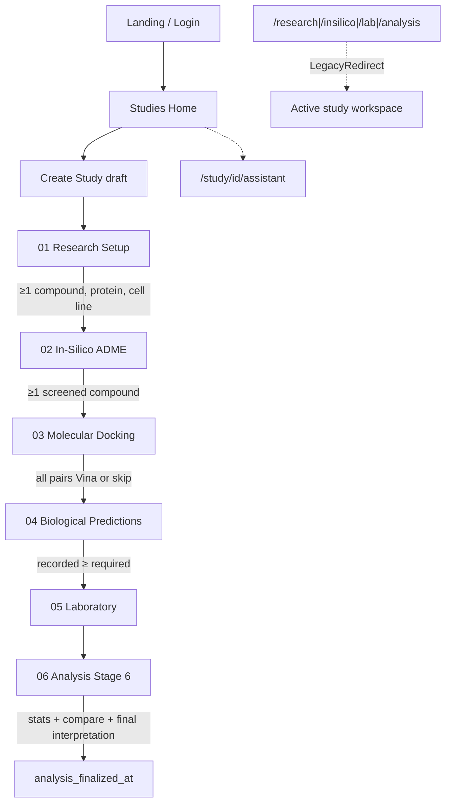
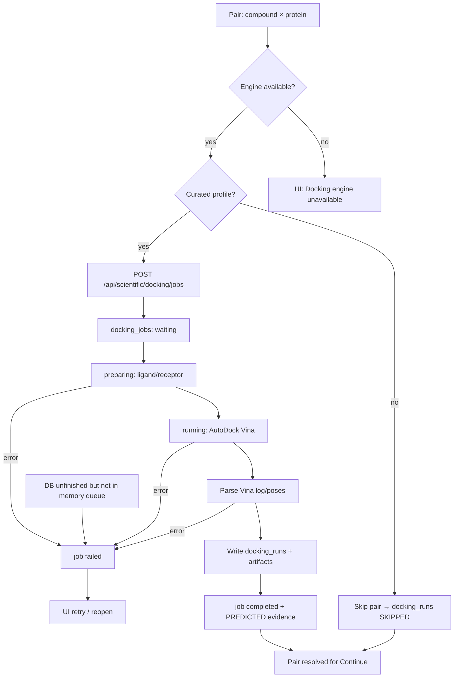

# HEPATOTEA – Comprehensive System Analysis and Technical Assessment

**Codebase:** `nanotophea` · **Product:** HEPATOTEA · **Package name:** `nano-hepatotea`  
**Analysis date:** November 2026  
**Scope:** Read-only source analysis — no application code was modified during this assessment.  
**Binding scientific contract:** [`STUDY_DESIGN_CONTRACT.md`](./STUDY_DESIGN_CONTRACT.md)

---

## 1. Executive Summary

**HEPATOTEA** is a Next.js 15 study-scoped bioinformatics workspace for *Phyllanthus niruri* research: setup → ADME → AutoDock Vina docking → biological predictions → laboratory → statistics/comparison/interpretation, plus Together AI assistance.

**Working well:** guided `/study/[id]/…` workflow, MySQL persistence, cookie sessions, PubChem/RCSB/AlphaFold/PubMed proxies, real Vina worker, Stage 6 analysis with evidence-class rules from the study design contract.

**Largest gaps:** authorization (roles always allow edit; several study APIs/repos lack membership checks; predictions API has no auth), README/docs still describe Firebase/import-only docking, biological predictions are **prototype simulations**, docking queue is in-process only.

Treat multi-user RBAC as aspirational until server-side membership/role checks are enforced.

---

## 2. System Overview

| Aspect | Reality |
|--------|---------|
| Product | HEPATOTEA — natural-products research platform |
| Domain | Computational + experimental study of phytochemicals (esp. NanoHepatoTea / HepG2) |
| Primary UX | Authenticated study workspace with 6 locked steps |
| Persistence | MySQL/MariaDB `nanotophea_db` |
| Scientific workers | Local/hosted AutoDock Vina; hosted ADMET-AI; Together AI |
| Binding contract | `docs/STUDY_DESIGN_CONTRACT.md` |

**Not:** a clinical dosing tool, report/PDF/Excel exporter, or validated QSAR engine (predictions are prototype).

> Computational outputs do not constitute experimental proof.

---

## 3. Technology Stack

| Layer | Technology |
|-------|------------|
| App | Next.js 15.2 (App Router), React 19, TypeScript |
| UI | Tailwind CSS 4, lucide-react, Recharts |
| Validation | Zod |
| DB | mysql2 → MySQL/MariaDB (`lib/db/mysql.ts`) |
| Auth | bcryptjs + `sessions` table + `nanotophea_session` cookie |
| AI | `together-ai` (`openai/gpt-oss-120b`) |
| Docking | AutoDock Vina + Python prep (`services/docking/`) |
| ADME | FastAPI ADMET-AI (`services/admet-api/`) or prototype table |
| External | PubChem, RCSB PDB, AlphaFold DB, PubMed/NCBI |

**Notes**

- `pg` / `pg-mem` appear in dependencies; the **active** persistence path is MySQL.
- Firebase Auth/Firestore are **removed** from the runtime path (legacy under `_archive/` only).
- Root `README.md` and several phase docs still describe Firebase — treat them as stale relative to source.

---

## 4. Project Architecture

```text
Browser (React)
  ├─ AuthProvider / StudyProvider / WorkflowStatusProvider
  ├─ AppShell → StudiesHome | StudyWorkspace | Landing/Login
  └─ fetch / Server Actions
        │
Next.js (Node)
  ├─ middleware.ts          cookie presence gate (pages only)
  ├─ app/api/**             auth, AI, scientific, studies
  ├─ lib/repositories/**    "use server" CRUD
  ├─ lib/workflow/**        readiness + step gates
  └─ lib/scientific|adme|predictions|docking|statistics|comparison|ai
        │
MySQL nanotophea_db
        │
Sidecars: Vina worker | ADMET-AI | Together API | PubChem/RCSB/AlphaFold/PubMed
```

### Communication patterns

- Most study data: client → Server Actions in repositories → parameterized SQL
- Jobs/engines: HTTP to `/api/scientific/*` then workers
- Workflow sidebar: `loadStudyReadiness` fans out ~13 parallel list queries

---

## 5. Project Directory Structure

| Path | Role |
|------|------|
| `app/` | Pages + API routes |
| `components/study/` | **Live** workspace UIs |
| `components/panels/` | Mostly **orphan** legacy panels |
| `components/ai/`, `landing/`, `auth/`, `layout/` | AI, marketing, login, shell |
| `lib/` | Domain, auth, DB, repos, workflow, science, AI |
| `migrations/` | `001`–`005` MySQL migrations |
| `services/docking/`, `services/admet-api/` | Scientific sidecars |
| `scripts/` | migrate, seed, verify, cleanup |
| `docs/` | Contract + phase/audit docs (mixed freshness) |
| `_archive/` | Legacy Vite/Firebase-era code |
| `tools/vina/` | Local Vina binary |
| `data/` | Catalog/nav fixtures, prototype ADME |
| `public/` | Static assets |
| `types/` | Shared types (evidence classes) |

### App routes (pages)

| Route | File / behavior |
|-------|-----------------|
| `/` | `app/page.tsx` → `StudiesHome` when signed in |
| `/study/[studyId]/[[...slug]]` | Primary guided workspace |
| `/research/*`, `/insilico/*`, `/lab/*`, `/analysis/*` | **LegacyRedirect** stubs → active study |

### Study workspace slugs (`lib/workflow/studyFlow.ts`)

- `/study/{id}/setup/{phytochemicals\|proteins\|cell-line\|nanoparticle}`
- `/study/{id}/insilico/{overview\|admet}`
- `/study/{id}/docking`
- `/study/{id}/predictions/{all\|dpph\|mtt\|ldh\|ros\|bax\|hippo-yap}`
- `/study/{id}/laboratory/{coverage\|dpph\|…\|hippo-yap}`
- `/study/{id}/analysis/{overview\|statistics\|comparison\|interpretation}`
- `/study/{id}/assistant` — Ask AI

---

## 6. Module and Feature Inventory

| Module | Purpose | Key files | Status |
|--------|---------|-----------|--------|
| Landing / Auth | Marketing + login | `components/landing/*`, `LoginScreen`, `AuthProvider` | **Fully** |
| Studies home | List/create/open/delete | `StudiesHome`, `studyRepository` | **Fully** |
| Setup | Phyto/proteins/cell lines/nanoparticle | `ResearchSetup`, `*Browser`, nanoparticle API | **Fully** (nanoparticle optional) |
| In-silico ADME | PubChem + Lipinski + ADME | `InSilicoWorkspace`, `/api/scientific/adme` | **Fully*** (engine or prototype) |
| Docking | Compound×protein Vina jobs | `DockingPairsWorkspace`, `services/docking/*` | **Fully*** (profile + env dependent) |
| Predictions | 6 endpoints | `BiologicalPredictionsWorkspace`, `lib/predictions/prototype/*` | **Partial** (prototype only; models `null`) |
| Laboratory | Experimental datasets | `LaboratoryWorkspace`, `labRepository` | **Fully** (DPPH/LDH richest) |
| Analysis | Stats + compare + interpret | `AnalysisInterpretation`, `Stage6Report` | **Fully** (compare DPPH/LDH) |
| Ask AI | Study chat + AI draft | `assistant-workspace`, `/api/ai/chat` | **Fully*** (needs API key) |
| Flat `/research\|/insilico\|/lab\|/analysis` | Legacy IA | `LegacyRedirect` | **Stubs** |
| `DashboardPanel`, import `DockingWorkspace`, `WorkspaceModules` | Old UI tree | `components/panels/*` | **Orphan / dead path** |

\* Runtime depends on env/services.

### Trace pattern (live path)

UI under `components/study/*` → server actions in `lib/repositories/*` and/or `app/api/scientific/*` → MySQL tables → readiness recompute in `loadStudyReadiness.ts` → sidebar/Continue rules in `studyFlow.ts`.

---

## 7. User Roles and Permissions Matrix

**Schema roles:** `OWNER | COLLABORATOR | ADVISER | VIEWER` on `users` and `study_members`.

| Capability | OWNER | COLLABORATOR | ADVISER | VIEWER | Code reality |
|------------|:-----:|:------------:|:-------:|:------:|--------------|
| Sign in / session | ✓ | ✓ | ✓ | ✓ | Enforced |
| Open protected pages | ✓ | ✓ | ✓ | ✓ | Cookie in middleware |
| Create study | ✓ | ✓ | ✓ | ✓ | Any signed-in user |
| Edit catalogs / runs / lab | ✓ | ✓ | ✓ | ✓ | `canEditResearchData` → **always `true`** |
| Delete study | ✓ | ✗* | ✗ | ✗ | Owner / OWNER member / system OWNER (`deleteStudy`) |
| AI chat on study | member/owner | member | member | member | `studyAccessAllowed` |
| ADME API | member/owner | … | … | … | `studyAccessAllowed` |
| Nanoparticle GET/POST | any auth | any auth | any auth | any auth | **No membership check** |
| Docking jobs | any auth | any auth | any auth | any auth | Session only |
| Predictions API | — | — | — | — | **No auth** |
| Repo server actions | any auth w/ studyId | … | … | … | No membership assert |

\* Unless also study OWNER member / system OWNER.

```ts
// lib/permissions/researchAccess.ts
export function canEditResearchData(_role: StudyRole | null | undefined): boolean {
  return true
}
```

Comment in source: *“One signed-in account authors every study record.”* Role values may exist on membership rows but do not limit access.

---

## 8. System Workflow Diagrams

### Main study flow



### Docking job lifecycle



### Workflow notes

- Rules: `lib/workflow/studyFlow.ts`; counts: `lib/workflow/loadStudyReadiness.ts`
- Six steps: `setup` → `insilico` → `docking` → `predictions` → `laboratory` → `analysis`
- Predictions Continue is soft; Laboratory entry requires prediction completeness
- Analysis unlock can occur with lab DPPH/LDH even if not all lab sections resolved
- No user-facing notifications beyond inline UI + `audit_logs`
- Study status is mostly manual except auto-`completed` on Stage 6 finalize when all steps complete

### End-to-end workflow summaries

#### Create study

1. Studies home → New Study  
2. `NewStudyModal` → `StudyProvider.createNewStudy` → `studyRepository.createStudy`  
3. Zod `CreateStudyInputSchema`  
4. Insert `studies` + owner `study_members`  
5. Navigate into setup; localStorage `nanotophea.activeStudyId`

#### Setup catalogs

1. Step `setup` tabs  
2. Add/remove via browsers → repository CRUD; nanoparticle → API  
3. Continue requires ≥1 compound, protein, cell line  
4. Nanoparticle optional; references catalog not on live setup tabs

#### ADME screening

1. Step `insilico`  
2. Assess one/all → hosted ADMET or prototype  
3. Screening complete = PubChem + Lipinski + ADME recorded  
4. Persist `admet_runs`

#### Docking

1. Cartesian pairs from screened compounds × proteins  
2. Run/skip/reopen; curated profiles required for Vina  
3. In-process queue; artifacts under `DOCKING_ARTIFACT_DIR`  
4. Continue when all expected pairs completed or skipped

#### Predictions

1. Prototype path via `/api/scientific/predictions` (`mode: "prototype"`)  
2. Persist `biological_predictions`  
3. Validated models not registered (`*Model = null`)

#### Laboratory

1. DPPH/LDH structured grids; other endpoints flexible panel  
2. Mark not-tested with reason; characterization supported  
3. Persist datasets/replicates; update study laboratory fields

#### Analysis

1. Stage 6 computes stats/comparisons; user writes interpretation (or AI draft)  
2. Finalize writes stats + comparisons + final interpretation  
3. Sets `analysis_finalized_at`; may set study `completed`

---

## 9. Database Architecture and Data Relationships

### Migrations

| ID | Purpose |
|----|---------|
| `001_initial_core_schema.ts` | Full core schema (~20 tables) |
| `002_performance_indexes.ts` | Extra indexes |
| `003_global_phytochemicals.ts` | Global phytochemical catalog |
| `004_nanoparticle_formulation.ts` | Nanoparticle formulations |
| `005_nanoparticle_refinements.ts` | Extra nanoparticle columns |

Runner: `npm run db:migrate` → `scripts/migrate.ts`. Canonical SQL reference: `lib/db/schema.sql`.

### Table groups

| Domain | Tables |
|--------|--------|
| Identity | `users`, `sessions`, `studies`, `study_members` |
| Catalogs | `phytochemicals`, `target_proteins`, `cell_lines`, `formulations`, `references`, `global_phytochemicals`, `nanoparticle_formulations` |
| In-silico | `admet_runs`, `docking_pairs`, `docking_runs`, `docking_jobs`, `biological_predictions` |
| Lab/analysis | `laboratory_datasets`, `laboratory_replicates`, `statistics_analyses`, `comparisons`, `interpretations` |
| Ops | `audit_logs`, `literature_cache` |

### Integrity observations

- FKs + cascades generally sound for study-scoped data
- Timestamps stored as `VARCHAR` ISO strings (consistent but non-native)
- Provenance as JSON with evidence class
- Indexes: base schema + migration `002`
- Queries are parameterized (`?`) — SQL injection risk low on inspected paths
- Repositories do not paginate; docking `modes` / large JSON can bloat reads
- Literature cache has no TTL
- Schema supports the workflow; authorization is application-layer (and incomplete)

### Repositories (`lib/repositories/`)

| File | Domain |
|------|--------|
| `userRepository.ts` | Auth users, password hash, last login |
| `studyRepository.ts` | CRUD studies, members, delete cascade |
| `researchDataRepository.ts` | Formulations, compounds, proteins, cell lines, refs, nanoparticle |
| `scientificRunRepository.ts` | ADMET, docking pairs/runs, predictions |
| `labRepository.ts` | Lab datasets + replicates |
| `statisticsRepository.ts` | ANOVA/Scheffé analyses |
| `comparisonRepository.ts` | Pred vs exp |
| `interpretationRepository.ts` | Interpretations |
| `auditRepository.ts` | Audit logs |
| `mysqlMappers.ts` | Row → domain model mapping |

---

## 10. API and Backend Services

| Endpoint | Auth | Membership | Notes |
|----------|------|------------|-------|
| `POST /api/auth/login` | public | — | Sets httpOnly cookie; also returns `token` in JSON |
| `POST /api/auth/logout` | session | — | |
| `GET /api/auth/session` | session | — | |
| `POST /api/ai/chat` | session | yes | Rate-limited in-memory |
| `GET/POST /api/scientific/adme` | session | yes | |
| `GET/POST /api/scientific/docking/jobs` | session | **no** | Can enqueue Vina on any studyId |
| `GET /api/scientific/docking/engine` | session | — | Engine inspect |
| `POST /api/scientific/predictions` | **none** | — | Prototype/engine compute |
| `GET /api/scientific/pubchem\|rcsb\|pubmed…` | **none** | — | Public scientific proxies |
| `GET/POST …/nanoparticle` | session | **no** | Cross-study read/write risk |
| `…/studies/[studyId]` | session | owner checks on delete | Better than peers |

**Server Actions:** `lib/repositories/*` — Zod on many writes; actor id for provenance; **no** central `assertStudyAccess`.

### Environment variables (`.env.example`)

| Variable | Purpose |
|----------|---------|
| `MYSQL_HOST`, `MYSQL_PORT`, `MYSQL_USER`, `MYSQL_PASSWORD`, `MYSQL_DATABASE` | DB (default `nanotophea_db`) |
| `DATABASE_URL` | Optional `mysql://…` URL |
| `NANOTOPHEA_ADMIN_EMAIL`, `NANOTOPHEA_ADMIN_PASSWORD` | Seed admin |
| `TOGETHER_API_KEY` | Together AI (server-only) |
| `VINA_BIN`, `DOCKING_PYTHON` | Local docking worker |
| `ADMET_API_URL`, `ADMET_API_KEY`, `ADMET_TIMEOUT_SECONDS` | Hosted ADMET-AI |

Also referenced in docking code/docs: `DOCKING_ARTIFACT_DIR`, `DOCKING_TIMEOUT_SECONDS`, `ADME_PYTHON`.

### Deployment artifacts

| Artifact | Role |
|----------|------|
| `.vercel/` | Linked Vercel project |
| `services/admet-api/render.yaml` | Render web service for ADMET API |
| `services/admet-api/Dockerfile` | Container build for ADMET API |
| `next.config.ts` | Dev origins, image hosts, legacy redirects |
| `setup.bat`, `scripts/setup.mjs` | Local bootstrap |

No root Docker Compose for the Next app; docking/ADME are local or separately hosted.

---

## 11. Authentication and Security Assessment

### Session model

- Cookie name: `nanotophea_session`
- Token: 32-byte hex; 7-day TTL in `sessions`
- Flags: `httpOnly`, `sameSite: lax`, `secure` in production
- Also accepts `Authorization: Bearer <token>`
- Middleware protects `/study`, `/analysis`, `/insilico`, `/lab`, `/research` by cookie **presence** only (APIs validate sessions themselves)

### Confirmed findings

| Finding | Severity | Evidence |
|---------|----------|----------|
| Study IDOR on nanoparticle + docking jobs | **Critical** | Auth without `studyAccessAllowed` / member check |
| Predictions API unauthenticated | **Critical** | `app/api/scientific/predictions/route.ts` |
| Repo mutations by studyId alone | **High** | e.g. `createCompound(studyId, actor, body)` |
| Roles not enforced | **High** | `researchAccess.ts` always true |
| Session token returned in login JSON | **Medium** | XSS/token leakage risk if stored client-side |
| Unauthenticated PubChem/PubMed/RCSB proxies | **Low–Medium** | Abuse/DoS of upstream/server |

### Mitigations already present

- httpOnly cookie, `sameSite: lax`, `secure` in production
- bcrypt + dummy hash on unknown email (timing hardening)
- Inactive users rejected; expired sessions purged
- AI/ADME membership checks
- Study delete owner checks
- Parameterized SQL

### Potential (needs runtime verification)

- CSRF on cookie-authenticated POSTs (`sameSite=lax` helps)
- Multi-instance docking race / queue loss
- Middleware only checks cookie presence, not validity

---

## 12. UI/UX Assessment

### Strengths

- Clear 6-step IA in `AppNav`
- Locked steps with readiness gating
- Loading/empty states in major workspaces
- Dialogs with Escape / `role="dialog"` in places
- Brand HEPATOTEA in shell/landing
- Dark research aesthetic via large `globals.css` token system
- Mobile drawer nav at `lg:` breakpoint

### Issues

- Dual IA: flat routes redirect to **active** study only — bookmarks can land on the wrong study
- README still documents flat routes as primary
- Mega workspaces (1.2k–1.9k lines) → dense desktop UIs; mobile secondary
- Prediction UI sanitizes “prototype” → weaker transparency vs contract
- Limited toast/system messaging
- Accessibility uneven (`aria-invalid`, focus traps, chart AT)
- Orphan panels increase maintenance confusion

---

## 13. Code Quality Assessment

| Area | Finding |
|------|---------|
| Size | `BiologicalPredictionsWorkspace` ~1867, `LaboratoryWorkspace` ~1782, `globals.css` ~9.9k lines |
| Duplication | Live study UIs vs dead `WorkspaceModules` / panels |
| Naming | HEPATOTEA / nanotophea / nano-hepatotea / NANO-HEPATOTEA |
| Types | Zod domain models strong; mappers use `any` loosely |
| State | Context + local hooks; no global store |
| Legacy | `_archive`, Firebase docs, unused import UI |
| Tests | Broad `npm test` suite (workflow, stats, comparison, phase11, docking, AI, etc.) |
| Error handling | `toUserFacingError`; docking poll sometimes swallows errors |

---

## 14. Performance and Scalability Assessment

| Concern | Status |
|---------|--------|
| Readiness fan-out (~13 queries) | Acceptable for single-user studies; costly at scale |
| No pagination | Limits large catalogs/runs |
| Docking concurrency = 1, in-memory | Single Node process; restart marks jobs interrupted |
| AI rate limit in-memory | Not shared across instances |
| Literature cache | Persistent but no expiry |
| Client bundles | Heavy workspaces + Recharts; partial `dynamic()` import |
| Multi-tenant / multi-instance | Not designed for horizontal scaling without durable queue |

**Verdict:** Suitable for lab/research group single-deployment use; not multi-region SaaS without queue/authz/pagination work.

Related: [`PERFORMANCE_AUDIT.md`](./PERFORMANCE_AUDIT.md) — several Firebase-era items fixed; remaining hot spots are readiness fan-out, unpaginated lists, docking payloads.

---

## 15. Existing Bugs and Technical Issues

| # | Description | Location | Severity | Recommended solution |
|---|-------------|----------|----------|----------------------|
| 1 | Cross-study nanoparticle R/W | `app/api/studies/[studyId]/nanoparticle/route.ts` | Critical | Assert membership before GET/POST |
| 2 | Cross-study docking list/enqueue | `app/api/scientific/docking/jobs/route.ts` | Critical | `studyAccessAllowed` + ownership of pair IDs |
| 3 | Predictions endpoint open | `app/api/scientific/predictions/route.ts` | Critical | Require session (and ideally study scope) |
| 4 | Server Actions lack membership | `lib/repositories/*` | High | Central `assertStudyAccess` |
| 5 | Role gates always true | `lib/permissions/researchAccess.ts` | High | Enforce ADVISER/VIEWER read-only **or** drop role claims |
| 6 | Docs say Firebase / no Vina | `README.md`, phase docs | Medium | Rewrite to MySQL + Vina truth |
| 7 | Prototype predictions vs branding | `lib/predictions/prototype/*`, UI sanitizer | High (scientific) / Medium (product) | Keep `SIMULATION` visible; stop scrubbing “prototype” |
| 8 | Docking queue non-durable | `services/docking/jobs.ts` | Medium | DB leases / external worker |
| 9 | Orphan UI confusion | `components/panels/*`, `WorkspaceModules` | Low–Medium | Delete or quarantine |
| 10 | DPPH µM vs µg/mL | contract + comparison | Not a bug | Ensure SIDE_BY_SIDE UX is clear |

Issues above are confirmed or strongly evidenced from source. Assumptions are not reported as confirmed bugs.

---

## 16. Incomplete or Missing Functionalities

- Validated biological prediction models (`*Model = null` in `lib/predictions/{dpph,mtt,ldh,ros,bax,hippo-yap}.ts`)
- Real role-based collaboration UI (invite/manage members appears schema-ready; enforcement incomplete)
- References catalog on live setup tabs
- Characterization as first-class workflow tab (handled in lab, not in `WORKFLOW_STEPS` tabs)
- Reports/PDF/Excel (intentionally out of scope per product contract)
- Push/email notifications
- File upload storage productization (`DOCKING_ARTIFACT_DIR` reserved)
- Durable multi-worker docking
- Literature cache TTL / multi-paper support

---

## 17. Recommended Improvements

### Priority 1 – Critical

1. **`assertStudyAccess` on every study-scoped API and repository** — nanoparticle, docking, all CRUD server actions  
2. **Authenticate `/api/scientific/predictions`**  
3. **Resolve RBAC policy** — either enforce ADVISER/VIEWER read-only or document single-author and remove misleading role docs  

### Priority 2 – Important

4. Rewrite README + MySQL setup; archive Firebase/phase docs that contradict code  
5. Durable docking queue + clearer restart messaging  
6. Honest SIMULATION labeling in predictions UI  
7. Pagination / slimmer docking payloads (`modes`)  
8. Stop returning session token in login JSON if unused  

### Priority 3 – Enhancement

9. Split mega-workspaces; remove orphans  
10. Mobile polish for docking/lab  
11. Literature cache TTL  
12. Membership management UI if collaboration is a real requirement  

---

## 18. Prioritized Development Roadmap

| Phase | Focus | Outcome |
|-------|--------|---------|
| **Now** | Authz hard gate | Safe multi-user MySQL deployment |
| **Next** | Docs + prediction honesty + docking durability | Trustworthy ops & science labeling |
| **Then** | Performance (pagination, readiness SQL) | Larger studies |
| **Later** | Validated prediction models / collaboration UX | Scientific upgrade without rewriting stack |

Do **not** replace Next.js/MySQL without strong cause — the stack fits the product; authz and scientific honesty are the blockers.

---

## 19. Overall System Assessment

HEPATOTEA is a **substantially rebuilt, study-centric research platform** with a clear scientific contract and a working end-to-end pipeline from catalog selection through Vina docking, lab entry, ANOVA/Scheffé, comparison, and interpretation/AI.

**Maturity:** strong as a single-lab research tool once env services are configured; **not production-safe for untrusted multi-user access** until membership/role gaps are closed.

### What another senior can trust immediately

- Live path is `/study/[id]/…` + MySQL + cookie auth  
- Evidence classes and DPPH unit separation are intentional  
- Docking is real Vina when profiles/engine exist  
- Predictions are exploratory simulations, not validated assays  

### What to fix before broader sharing

- Study-scoped authorization  
- README/docs drift  
- Transparent SIMULATION labeling  

### Related documentation (freshness varies)

| Doc | Use |
|-----|-----|
| `docs/STUDY_DESIGN_CONTRACT.md` | Binding scientific rules |
| `docs/FIREBASE_REMOVAL_AUDIT.md` | Historical plan matching current MySQL direction |
| `docs/PERFORMANCE_AUDIT.md` | Performance findings (partially remediated) |
| `docs/PHASE1`–`PHASE11_*.md` | Incremental delivery notes; often Firebase-era |
| `docs/CURRENT_SYSTEM_AUDIT.md` | Pre-rebuild prototype baseline |
| `NANOTOPHEA_Final_Redevelopment_Plan.md` | Overall redevelopment plan |
| `README.md` | **Stale** — still describes Firebase stack |

---

*End of assessment. Generated from source analysis of `c:\projects\nanotophea`.*
